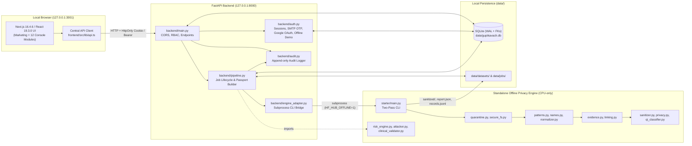
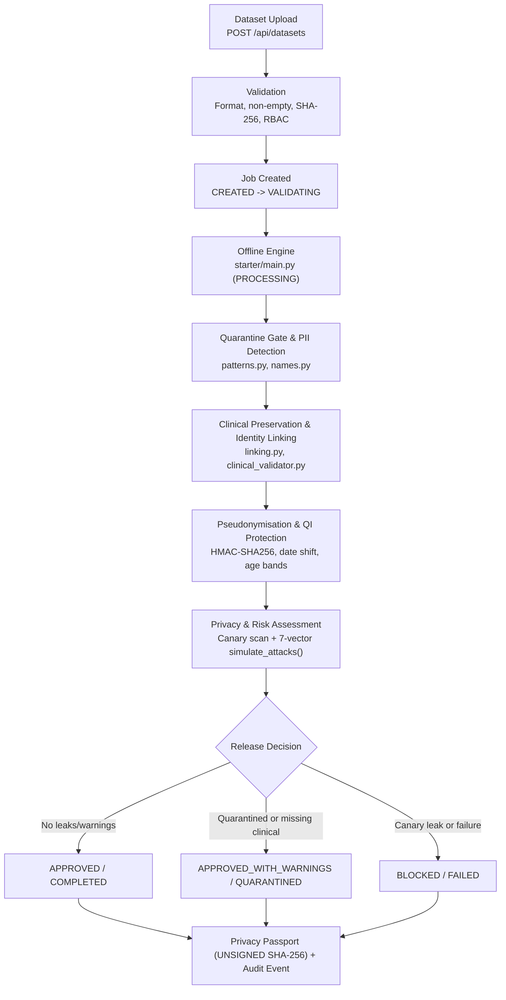

# MediLocker

**Protect the Identity. Preserve the Medicine. Enable Collaboration.**

MediLocker is an offline-first healthcare data privacy platform designed to help healthcare organisations sanitise sensitive medical records while preserving clinically valuable information and enabling privacy-conscious research collaboration.

> **Hackathon Track:** Yugaantar DevForge Hackathon — **Track 3: Secret Wards** (`Team Halfwave`, confirmed in `starter/raksha.toml`).  
> **Core Privacy Engine:** Built on the standalone **GuptKavach (RAKSHA)** deterministic, CPU-only, LLM-free privacy engine in `starter/`.

---

# One-Click Verification

Run the complete offline verification suite (engine execution, official output contract check, submission checker, clinical integrity, clinical drift, attack simulation, cryptography, multilingual PII, privacy passport, PDF reporting, and E2E workflow tests) with one command:

**Windows (PowerShell):**
```powershell
.\scripts\verify_submission.ps1
```

**Linux / macOS (Bash):**
```bash
bash scripts/verify_submission.sh
```

See [docs/VERIFICATION_GUIDE.md](docs/VERIFICATION_GUIDE.md) for detailed stage descriptions and manual checker commands.

---

## Table of Contents

1. [Problem Statement & Approach](#1-problem-statement--approach)
2. [Architecture & Processing Lifecycle](#2-architecture--processing-lifecycle)
3. [Dashboard Modules & Capabilities](#3-dashboard-modules--capabilities)
4. [Technical Stack](#4-technical-stack)
5. [Offline-First & Hackathon Compliance](#5-offline-first--hackathon-compliance)
6. [Installation & Execution](#6-installation--execution)
7. [API Documentation](#7-api-documentation)
8. [Security & Privacy Controls](#8-security--privacy-controls)
9. [Testing & Verified Benchmarks](#9-testing--verified-benchmarks)
10. [PDF Reporting (`generate_pdf.py`)](#10-pdf-reporting-generate_pdfpy)
11. [Repository Structure](#11-repository-structure)
12. [Screenshots & Visual Documentation](#12-screenshots--visual-documentation)
13. [Attribution & License](#13-attribution--license)

---

## 1. Problem Statement & Approach

### The Problem
- **Sensitive Identifiers:** Clinical exports contain direct identifiers (patient names, relative names, phone numbers, Aadhaar, ABHA, PAN, MRN/UHID, emails, addresses) across structured columns, free-text notes, filenames, JSON keys, metadata paths, and base64 payloads.
- **Cross-Hospital Fragmentation:** Multiple hospitals and diagnostic labs store fragmented records for the same patient in different scripts (English, Hindi/Devanagari, Hinglish transliterations) and local registration IDs.
- **Quasi-Identifier Exposure:** Combinations of exact dates, ages, villages, and PIN codes allow linkage and singling-out attacks even after direct names are removed.
- **Clinical Utility Loss:** Naive redaction destroys medical eponyms (*Parkinson's*, *Addison's*, *Crohn's*), doctor titles (`Dr. Sharma`), drug dosages (`650mg`), lab units (`mg/dL`), and FHIR R4 structural references.
- **Lack of Pre-Release Verification:** Organisations need measurable privacy, clinical integrity, and adversarial attack evidence before releasing a dataset.

### MediLocker's Approach
MediLocker pairs a **standalone, zero-dependency Python privacy engine (`starter/`)** with an **integrated local FastAPI + SQLite + Next.js platform (`backend/`, `frontend/`, `launcher/`)**:
- **Deterministic Two-Pass Sanitisation:** Pass 1 ingests multi-encoding files, quarantines unsafe/malformed inputs, classifies columns/keys, builds a corpus-wide multilingual name index, and resolves patient clusters conservatively. Pass 2 redacts direct PII, injects keyed `HMAC-SHA256` pseudonyms (`PSN-XXXXXX`), shifts dates per patient (`±180` days), generalizes ages/PINs, and emits `sanitized/`, `report.json`, and `records.jsonl`.
- **Evidence-Based Release Gating:** Every web job runs canary scanning, HL7 FHIR R4 / clinical value validation, and a 7-vector re-identification attack simulator before issuing a release decision and a SHA-256 hash-verified Privacy Passport (`UNSIGNED`).

---

## 2. Architecture & Processing Lifecycle

Detailed diagrams and component tables are in [`docs/ARCHITECTURE.md`](docs/ARCHITECTURE.md).

### System Architecture



### Dataset Processing Lifecycle



---

## 3. Dashboard Modules & Capabilities

Full module-by-module capabilities and limitations are documented in [`docs/FEATURES_AND_LIMITATIONS.md`](docs/FEATURES_AND_LIMITATIONS.md).

| Module | Route | Status | Description & Backend Source |
|---|---|---|---|
| **Dashboard** | `/dashboard` | `IMPLEMENTED` | Release readiness (`NOT_RUN`..`BLOCKED`), first-run onboarding, 6 clickable metrics, 6-stage workflow, Recent Jobs, Audit Events (`GET /api/dashboard/overview`). |
| **Datasets** | `/dashboard/datasets` | `IMPLEMENTED` | Upload `.csv`, `.tsv`, `.json`, `.jsonl`, `.txt`, `.pdf`, `.png`, trigger processing, poll stage, download ZIP (`GET/POST /api/datasets`, `DELETE /api/datasets/{id}`). |
| **Privacy Engine** | `/dashboard/privacy-engine` | `IMPLEMENTED` | 5-stage pipeline inspection, `RAKSHA_SECRET` status, persistent job history (`GET /api/jobs`, `GET /api/settings`). |
| **Privacy Intelligence** | `/dashboard/privacy-intelligence` | `IMPLEMENTED` | Measured PII counts, residual canary leaks, QI risk score, release eligibility (`GET /api/privacy-intelligence`). |
| **Attack Simulator** | `/dashboard/attack-simulator` | `IMPLEMENTED` | Executes 7-vector deterministic re-identification attacks via `simulate_attacks()` (`GET /api/threat-lab`, `POST /api/attack-simulator/run`). |
| **Organisations** | `/dashboard/organisations` | `IMPLEMENTED` | Lists authorised hospitals/labs/institutes and contributed counts; `PLATFORM_ADMIN` creation (`GET/POST /api/organisations`). |
| **Identity Continuity** | `/dashboard/identity-continuity` | `IMPLEMENTED` | Pseudonymous `PSN-XXXXXX` clusters, cross-hospital links, precision/recall/F0.5, abstentions (`GET /api/identity/clusters`). |
| **Clinical Integrity** | `/dashboard/clinical-integrity` | `IMPLEMENTED` | Exact preserved/expected clinical numerators & denominators, HL7 FHIR R4 validation (`GET /api/clinical/reports`). |
| **Privacy Passports** | `/dashboard/privacy-passports` | `IMPLEMENTED` | `UNSIGNED` SHA-256 hash-verified manifests, hash verification, JSON/HTML export (`GET /api/passports`, `POST .../verify`, `GET .../download`). |
| **Research Network** | `/dashboard/research-network` | `IMPLEMENTED` | Governed research requests (`SUBMITTED`, `APPROVED`, `REJECTED`) with RBAC (`GET/POST /api/research/requests`). |
| **Audit Trail** | `/dashboard/audit` | `IMPLEMENTED` | Paginated append-only operational event log (`GET /api/audit/events`). |
| **Settings** | `/dashboard/settings` | `IMPLEMENTED` | Active user/role, SMTP & Google OAuth status, policy thresholds (`GET/POST /api/settings`). |

---

## 4. Technical Stack

### Runtime Dependencies (Application & Engine)
- **Offline Privacy Engine (`starter/`):** Python 3.10+ (tested on `3.14.7`), **Python Standard Library only** (`csv`, `json`, `hmac`, `hashlib`, `re`, `unicodedata`, `base64`, `datetime`, `pathlib`).
- **Backend Web API (`backend/`):** `FastAPI 0.165.0`, `Uvicorn 0.54.0`, `Pydantic 2.14.4`, `Starlette 1.10.0`, `python-multipart 0.0.34`, `google-auth 2.63.1`, `requests 2.34.2`.
- **Database:** Local SQLite (`data/guptkavach.db`) with `PRAGMA foreign_keys = ON` and `WAL` mode.
- **Frontend (`frontend/`):** `Next.js 16.4.6` (Turbopack), `React 19.3.0`, `TypeScript 5.9.3`, `Tailwind CSS 4.3.3` (`@tailwindcss/turbopack`), `lucide-react 1.80.0`, `pnpm 12.18.0`.
- **Standalone PDF Utility (`generate_pdf.py`):** `reportlab`.

### Development & Testing Tools (Not Required by `starter/main.py`)
- `pytest 9.2.0`, `httpx 0.28.1`, `eslint 9`, `eslint-config-next 16.4.6`.

---

## 5. Offline-First & Hackathon Compliance

- **CPU-Only & Air-Gapped Engine:** `starter/main.py` uses zero GPUs, zero LLMs, zero pretrained transformers, and zero runtime network calls (`HF_HUB_OFFLINE=1`, `TRANSFORMERS_OFFLINE=1`).
- **Decoupled Authentication:** Web authentication (SMTP Email OTP and Google OAuth 2.0) lives strictly in `backend/auth.py` and is never imported or required by `starter/main.py` or `validate_output.py`.
- **Offline Local Demo Mode:** Launching via `launcher/medilocker_launcher.py` or `Start-MediLocker.bat` sets `MEDILOCKER_OFFLINE_MODE=true` and binds strictly to `127.0.0.1` (`8000` & `3001`), enabling full console operation with zero internet.
- **Secret-Dependent Pseudonymisation:** `RAKSHA_SECRET` is read from the environment for `HMAC-SHA256` pseudonyms and date shifts; different secrets produce mutually unlinkable pseudonym spaces.
- **Synthetic Data Only:** `dev/input/` and all test corpora contain synthetic records only.

---

## 6. Installation & Execution

Full instructions (including Linux and Windows distribution packaging) are in [`docs/REPRODUCIBILITY.md`](docs/REPRODUCIBILITY.md), [`docs/OFFLINE_SETUP_GUIDE.md`](docs/OFFLINE_SETUP_GUIDE.md), and [`docs/WINDOWS_BUILD_GUIDE.md`](docs/WINDOWS_BUILD_GUIDE.md).

### 1. Setup (Windows PowerShell)
```powershell
git clone https://github.com/DhyanK567/Yugaantar-Scaler-Hackathon.git
cd Yugaantar-Scaler-Hackathon

python -m venv .venv
.\.venv\Scripts\Activate.ps1

pip install -r starter\requirements.txt
pip install fastapi uvicorn python-multipart google-auth requests httpx pytest reportlab

cd frontend
pnpm install
pnpm build
cd ..
```

### 2. Run Offline-First Local Application (Recommended)
```powershell
.\.venv\Scripts\python.exe launcher\medilocker_launcher.py
# Or double-click Start-MediLocker.bat
```
Opens `http://127.0.0.1:3001/login` with **Continue in Offline Demo Mode** active.

### 3. Run in Development Mode
```powershell
# Terminal 1 (Backend)
.\.venv\Scripts\uvicorn.exe backend.main:app --host 127.0.0.1 --port 8000 --reload

# Terminal 2 (Frontend)
cd frontend; pnpm dev -p 3001
```

### 4. Run Independent CLI Evaluator (No Web Server)
```powershell
$env:RAKSHA_SECRET="practice"
.\.venv\Scripts\python.exe starter\main.py --input dev\input --output my_output_verify
.\.venv\Scripts\python.exe validate_output.py --input dev\input --output my_output_verify
.\.venv\Scripts\python.exe check_dev.py --output my_output_verify --show 10
.\.venv\Scripts\python.exe check_submission.py --repo starter
```

### 5. Environment Variables
| Variable | Purpose | Where Used |
|---|---|---|
| `RAKSHA_SECRET` | HMAC-SHA256 key for pseudonyms & date shifts (defaults to `"practice"` in adapter if unset) | `starter/main.py`, `backend/engine_adapter.py` |
| `MEDILOCKER_AUTH_SECRET` | HMAC key for OTP hashes (ephemeral fallback in dev if unset) | `backend/auth.py` |
| `MEDILOCKER_OFFLINE_MODE` | Enables `POST /api/auth/offline-demo` when `"true"` | `backend/auth.py`, `launcher/medilocker_launcher.py` |
| `MEDILOCKER_ENV` | `"development"` (default) or `"production"` (sets `Secure` cookies, disables dev-login) | `backend/auth.py` |
| `MEDILOCKER_DB_PATH` | Optional SQLite DB path override | `backend/database.py` |
| `FRONTEND_ORIGINS` | Comma-separated CORS origins | `backend/main.py` |
| `SMTP_HOST`, `SMTP_PORT`, `SMTP_USERNAME`, `SMTP_PASSWORD`, `SMTP_FROM_EMAIL`, `SMTP_FROM_NAME`, `SMTP_USE_TLS` | Optional SMTP Email OTP configuration | `backend/auth.py` |
| `GOOGLE_CLIENT_ID`, `GOOGLE_CLIENT_SECRET`, `GOOGLE_REDIRECT_URI` | Optional Google OAuth 2.0 / OIDC configuration | `backend/auth.py` |

---

## 7. API Documentation

All protected endpoints require either an `HttpOnly` `medilocker_session` cookie or an `Authorization: Bearer <token>` header.

| Method | Endpoint | Purpose | Auth |
|---|---|---|---|
| `GET` | `/api/health` | Health and air-gapped engine status | Public |
| `GET` | `/api/auth/config` | Returns `offline_mode`, `smtp_enabled`, `dev_email_login_enabled`, `google_enabled` | Public |
| `POST` | `/api/auth/register` | Register user email and default membership | Public |
| `POST` | `/api/auth/otp/request` | Dispatch 6-digit OTP via SMTP (rate-limited, anti-enumeration) | Public |
| `POST` | `/api/auth/otp/verify` | Verify OTP and issue session cookie/token | Public |
| `GET` | `/api/auth/google/login` | Generate Google OAuth 2.0 + PKCE + state + nonce URL | Public |
| `GET`/`POST` | `/api/auth/google/callback` | Exchange code, verify ID token, create session | Public |
| `POST` | `/api/auth/offline-demo` | Local offline demo session (`MEDILOCKER_OFFLINE_MODE=true` only) | Public (Offline) |
| `GET` | `/api/auth/me` | Current user, memberships, active role | User |
| `POST` | `/api/auth/switch-org` | Switch active organisation on session | User (Org Member) |
| `POST` | `/api/auth/logout` | Revoke session and clear cookie | User |
| `GET` | `/api/dashboard/overview` | Full dashboard metrics, readiness, recent jobs, audit events | User |
| `GET`/`POST` | `/api/organisations` | List authorised orgs / create org (`PLATFORM_ADMIN` for POST) | User / Admin |
| `GET`/`POST` | `/api/datasets` | List datasets / upload & trigger pipeline | User / Privacy Officer+ |
| `DELETE` | `/api/datasets/{id}` | Soft-delete dataset | Org Admin / Privacy Officer |
| `GET`/`POST` | `/api/jobs` | List jobs / start job on dataset | User / Privacy Officer+ |
| `GET` | `/api/jobs/{id}` | Job detail + stage events | Org Member |
| `GET` | `/api/jobs/{id}/results` | Privacy, clinical, identity, and passport results | Org Member |
| `GET` | `/api/jobs/{id}/download` | Download ZIP (`sanitized/`, `report.json`, `privacy_passport.json`; `records.jsonl` excluded by default) | Org Member |
| `GET` | `/api/jobs/{id}/report.json` | Download processing `report.json` | Org Member |
| `GET` | `/api/jobs/{id}/mapping` | Restricted download of sensitive `records.jsonl` patient mapping | Org Admin / Privacy Officer |
| `GET` | `/api/jobs/{id}/privacy-report.pdf` | Generate 3-page MediLocker Privacy & Integrity Report PDF | Org Member |
| `GET` | `/api/privacy-intelligence` | Aggregated privacy assessments | Org Member |
| `GET` | `/api/identity/clusters` | Pseudonymous identity graph & metrics | Org Member |
| `GET` | `/api/clinical/reports` | Clinical preservation & FHIR R4 reports | Org Member |
| `GET` | `/api/threat-lab` | Latest & historical attack simulator runs | Org Member |
| `POST` | `/api/attack-simulator/run` | Execute 7-vector attack simulation on a job | Privacy Officer+ |
| `GET` | `/api/passports` | List Privacy Passports | Org Member |
| `POST` | `/api/passports/{id}/verify` | Verify manifest SHA-256 integrity | Org Member |
| `GET` | `/api/passports/{id}/download` | Export passport (`?format=json` or `?format=html`) | Org Member |
| `GET`/`POST` | `/api/research/requests` | List / submit research collaboration requests | Researcher+ |
| `POST` | `/api/research/requests/{id}/approve` | Approve request | Privacy Officer+ |
| `POST` | `/api/research/requests/{id}/reject` | Reject request | Privacy Officer+ |
| `GET` | `/api/audit/events` | Paginated append-only audit trail | User |
| `GET`/`POST` | `/api/settings` | Read / update policy settings | User / Privacy Officer+ |

### Example Request (Synthetic)
```bash
curl -X POST http://127.0.0.1:8000/api/auth/offline-demo \
  -H "Content-Type: application/json" \
  -d '{"email": "privacy@metrogeneral.org"}'
```

---

## 8. Security & Privacy Controls

| Control | Implementation | File(s) |
|---|---|---|
| **PII Detection & Medical Guards** | Dual Latin-Devanagari regexes, Hinglish/Hindi transliteration, medical eponyms & dosage guards | `starter/raksha_engine/patterns.py`, `names.py`, `sanitizer.py` |
| **Pseudonymisation & Date Shifting** | Keyed `HMAC-SHA256` (`PSN-XXXXXX`) and per-patient `±180`-day secret date shifts | `starter/raksha_engine/privacy.py`, `crypto.py` |
| **Conservative Identity Resolution** | Candidate blocking + Union-Find over strong IDs & corroborated names; demographic conflict checks prevent homonym merges | `starter/raksha_engine/linking.py`, `evidence.py` |
| **Quarantine & Path Safety** | Isolates unsupported/corrupt/oversized inputs; `sanitize_filename` strips path traversal | `starter/raksha_engine/quarantine.py`, `backend/main.py` |
| **Atomic & Safe File Handling** | Atomic `.tmp` + `os.replace` for `report.json`; no raw PII in logs or stdout | `starter/main.py`, `backend/audit.py` |
| **Authentication & OTP Hardening** | Cryptographic 6-digit OTP, HMAC-SHA256 hashed storage, 5-min expiry, 5-attempt lockout, 60s cooldown, PKCE + nonce Google OIDC | `backend/auth.py` |
| **RBAC & Org Isolation** | `PLATFORM_ADMIN`, `ORG_ADMIN`, `PRIVACY_OFFICER`, `RESEARCHER`, `AUDITOR`; org membership verified on every endpoint | `backend/auth.py`, `backend/main.py` |
| **Audit Trail** | Append-only `audit_events` table excluding OTPs, secrets, and raw PII | `backend/audit.py`, `backend/database.py` |

> **Scope & Claims Note:** MediLocker implements deterministic sanitization, quasi-identifier generalization, and RBAC/audit controls. It does **not** claim formal $(\varepsilon, \delta)$-differential privacy, federated learning, secure multiparty computation, zero-knowledge proofs, or external regulatory certification.

---

## 9. Testing & Verified Benchmarks

### Automated Test Suites (Verified Passing)
- **Milestone 17 & 18 Integration, Auth, RBAC & Strict Offline Suite:**
  ```powershell
  .\.venv\Scripts\python.exe -m pytest tests\milestone_17\test_milestone_17.py tests\milestone_18\test_offline_verification.py -v
  ```
  - **Result:** **16/16 passed** (`24.91s`), with all non-loopback network sockets blocked during offline verification.
- **Official Submission Checker:**
  ```powershell
  .\.venv\Scripts\python.exe check_submission.py --repo starter
  ```
  - **Result:** **`READY TO SUBMIT`**
- **Frontend Production Build:**
  ```powershell
  cd frontend; pnpm build
  ```
  - **Result:** **22/22 routes compiled cleanly** with zero TypeScript errors.

### Synthetic Practice Benchmark (`dev/input`, from `docs/MILESTONE_14_REPORT.md`)
Measured on synthetic benchmark dataset `dev/input` (`200` files, `823` records, `645,582` input bytes) under CPU-only execution:

| Metric | Measured Result |
|---|---|
| Output Contract (`validate_output.py`) | `CONTRACT OK` |
| Files Sanitised / Quarantined | `195` / `5` |
| Residual Personal Data Leakage (`check_dev.py`) | `1.1%` overall (`content 0.0%`, `devanagari 0.0%`, `hinglish 0.0%`) |
| Canary Leaks | `0 / 4` |
| Clinical Values Preserved | `4,449 / 4,457` (`99.8%`) |
| Identity Precision / Recall / F0.5 | `1.00` / `0.76` / `0.94` (`0` false merges) |
| Adversarial Identity Suite (`run_identity_benchmark.py`) | Precision `1.000`, Recall `1.000`, F0.5 `1.000`, Order invariance `True` |
| Wall-Clock Runtime (`dev/input`) | `6.99s` – `7.35s` (mean `7.17s`), `< 20 MB` peak Python traced memory |
| Large Synthetic Stress Run (`benchmark_suite.py`, `5,000` files / `6,125` records) | `103.61s` (`48.3` files/sec) |
| Determinism (`2` runs, same secret) | `100%` byte-identical across `195` sanitised files and `823` records |
| Real-World Production Dataset Benchmark | **Not yet measured** (synthetic data only) |

---

## 10. PDF Reporting (`generate_pdf.py` & Live Privacy Report)

- **2-Page Project Brief (`generate_pdf.py`):** Standalone utility generating `starter/GuptKavach_Project_Brief.pdf` and `docs/GuptKavach_Project_Brief.pdf` (plus `submission/MediLocker_Project_Brief.pdf`).
- **Live 3-Page Privacy & Integrity Report (`backend/privacy_report_pdf.py`):** Authenticated endpoint `GET /api/jobs/{job_id}/privacy-report.pdf` wired to the dashboard (`Protect Data`, `Datasets`, and `Reports` pages) generating a 3-page monochrome assessment PDF from live SQLite & Privacy Passport verification data.

---

## 11. Repository Structure

```text
Secret-Wards-ToolKit/
├── backend/                     # FastAPI API, SQLite DB, Auth (OTP/Google/Offline), Pipeline
├── docs/                        # Architecture, Reproducibility, Milestone reports, Specs
├── frontend/                    # Next.js 16.4.6 + React 19.3.0 + Tailwind 4.3.3 UI
├── launcher/                    # Offline-first loopback launcher (medilocker_launcher.py)
├── scripts/                     # Windows distribution build script (build_windows_dist.ps1)
├── starter/                     # Standalone offline CPU-only privacy engine (GuptKavach/RAKSHA)
│   ├── config/policy.yaml       # Privacy & risk thresholds
│   ├── raksha_engine/           # Core detection, linking, clinical & attack modules
│   └── main.py                  # Official CLI entrypoint
├── tests/                       # Milestone 17, 18, adversarial, identity & performance suites
├── dev/                         # Official 200-file synthetic practice dataset & truth
├── Start-MediLocker.bat         # Windows double-click offline launcher
├── generate_pdf.py              # Standalone 2-page brief PDF generator
├── validate_output.py           # Official output contract validator
├── check_dev.py                 # Official practice scoring tool
├── check_submission.py          # Official submission readiness checker
└── test_guptkavach_system.py    # 11-point system regression suite
```

---

## 12. Screenshots & Visual Documentation

No UI screenshot image files are currently stored in the repository. See [`docs/screenshots/README.md`](docs/screenshots/README.md) for the recommended capture list.

---

## 13. Attribution & License

- Built by **Team Halfwave** for **Yugaantar DevForge Hackathon — Track 3: Secret Wards**, extending the official Secret Wards starter toolkit.
- Licensed under the terms in [`LICENSE`](LICENSE).
