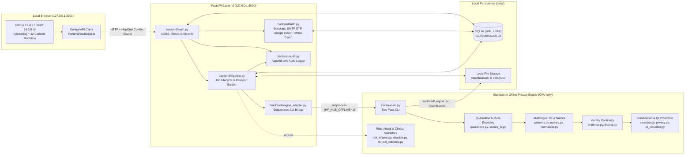
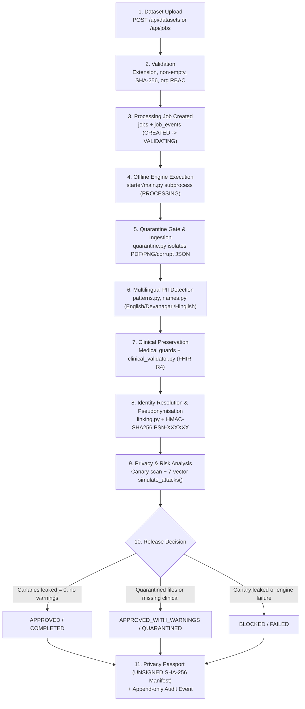

# MediLocker Architecture

This document describes the implemented architecture of **MediLocker** (built on the GuptKavach / RAKSHA offline privacy engine).

---

## 1. High-Level System Architecture

---

## 2. Dataset Processing Lifecycle

---

## 3. Component Summary

| Layer | Implementation Files | Responsibility |
|---|---|---|
| **Frontend Shell & Pages** | `frontend/src/components/layout/`, `frontend/src/components/dashboard/`, `frontend/src/app/` | Marketing site, Login/OTP/OAuth callback, 7-section Dashboard, 12 console modules. |
| **Desktop / Local Launcher** | `launcher/medilocker_launcher.py`, `Start-MediLocker.bat` | Single-instance lockfile, port checks, SQLite init, loopback `127.0.0.1` startup, WAL checkpoint on exit. |
| **Backend API & Auth** | `backend/main.py`, `backend/auth.py`, `backend/audit.py` | RBAC (`PLATFORM_ADMIN`, `ORG_ADMIN`, `PRIVACY_OFFICER`, `RESEARCHER`, `AUDITOR`), SMTP Email OTP, Google OAuth 2.0/OIDC, Offline Demo Mode. |
| **Pipeline & Engine Bridge** | `backend/pipeline.py`, `backend/engine_adapter.py` | Orchestrates `starter/main.py`, canary scanning, FHIR R4 clinical validation, `simulate_attacks`, and Privacy Passport generation. |
| **Offline Privacy Engine** | `starter/main.py`, `starter/raksha_engine/*.py` | Standalone Python stdlib-only two-pass engine; executes independently of FastAPI, Next.js, and network access. |
| **Database** | `backend/database.py` | SQLite (`data/guptkavach.db`) with `PRAGMA foreign_keys = ON` and `WAL` mode across 16 tables. |
| **PDF Utility (Standalone)** | `generate_pdf.py` | Standalone ReportLab generator producing the 2-page `GuptKavach_Project_Brief.pdf`. |
